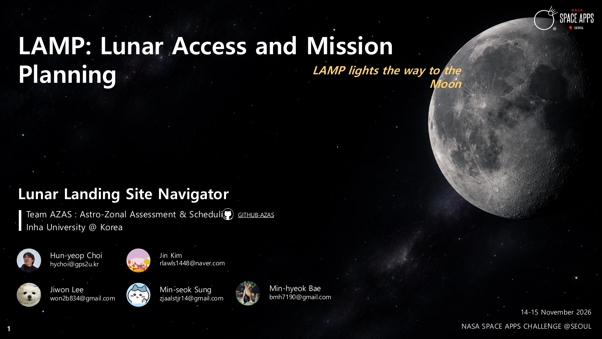
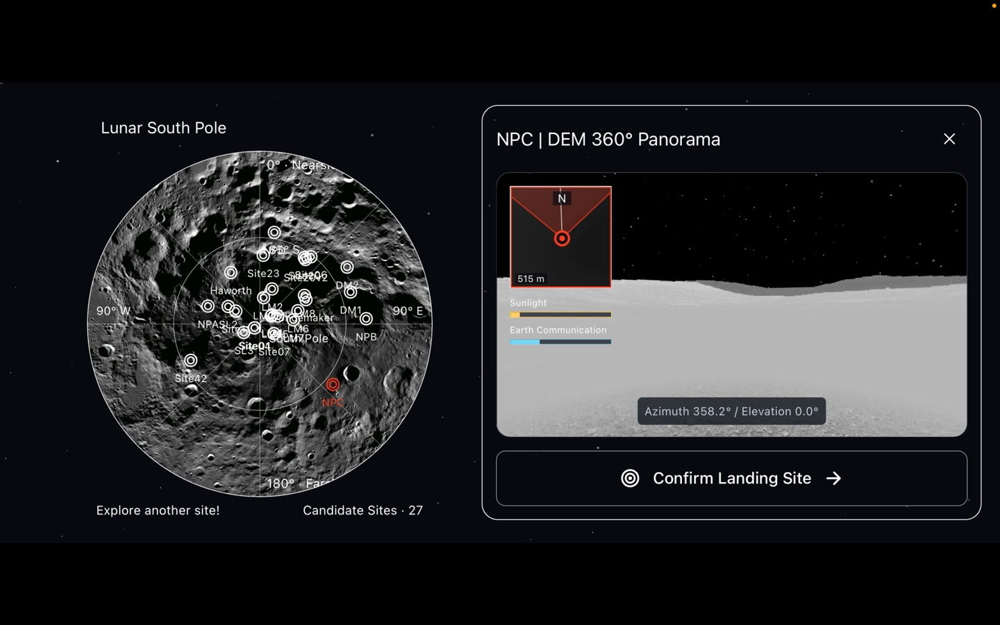
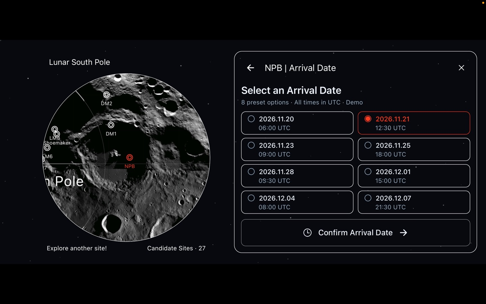
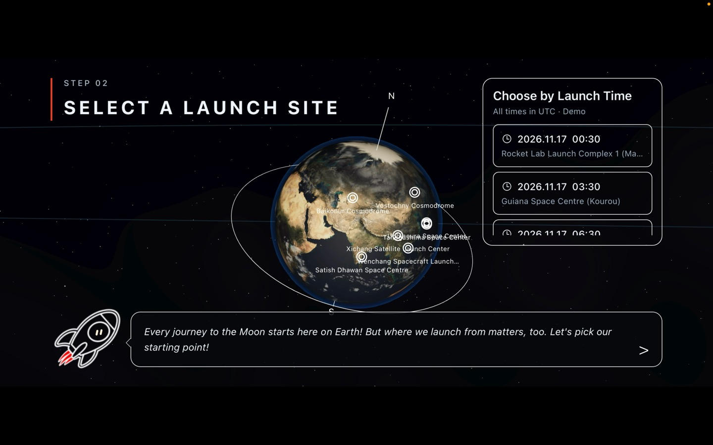
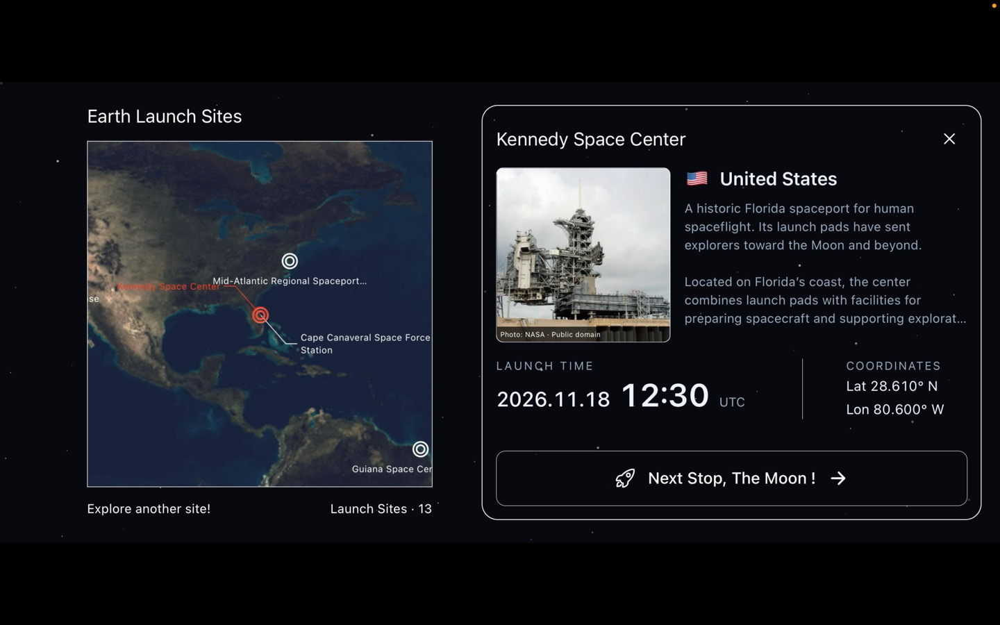
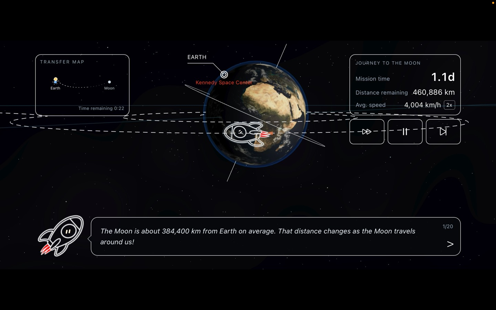
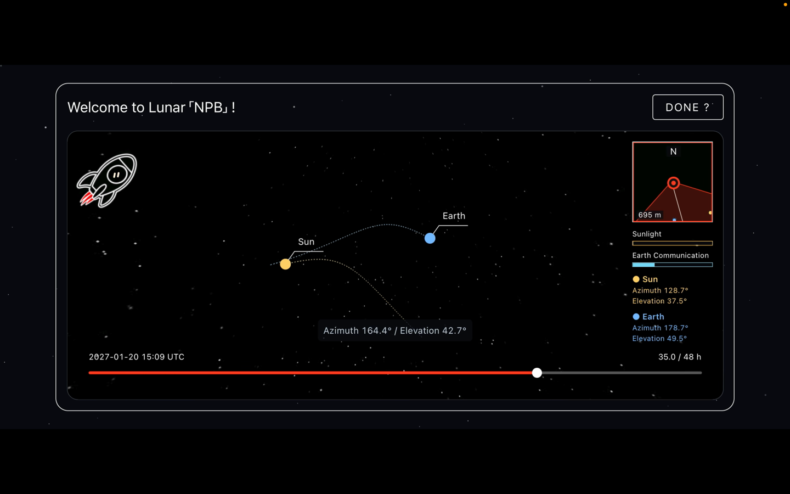

## Team AZAS

We’re a team of five from Inha University in South Korea. Our name, **AZAS**, stands for **Astro-Zonal Assessment & Scheduling**. We built LAMP for the 2026 NASA Space Apps Challenge in Seoul so that students, educators, and anyone curious about the Moon can plan a lunar mission and see how their choices play out.

## What we built

**LAMP (Lunar Access and Mission Planning)** is an interactive explorer for the Moon’s south pole. Choose any of the 27 candidate landing sites and set a mission deadline. LAMP checks the local terrain to find the earliest touchdown that keeps both the Sun and Earth in view for 48 consecutive hours. If a window is available, you can choose a launch site on Earth, follow a preliminary trajectory to the Moon, and move the surface timeline to see where the Sun and Earth appear above the lander’s horizon.

<table>
  <tr>
    <td width="33%" align="center" valign="top">
       
      Explore landing sites
    </td>
    <td width="33%" align="center" valign="top">
       
      Choose an arrival date
    </td>
    <td width="33%" align="center" valign="top">
       
      Compare launch sites
    </td>
  </tr>
  <tr>
    <td align="center" valign="top">
       
      Check launch details
    </td>
    <td align="center" valign="top">
       
      Follow the flight to the Moon
    </td>
    <td align="center" valign="top">
       
      Track the Sun and Earth
    </td>
  </tr>
</table>

## Links & contact

[Live demo](https://azas-app.vercel.app/) · [Team GitHub](https://github.com/NASA-AZAS) · [Frontend](https://github.com/NASA-AZAS/AZAS-FE) · [API documentation](https://api.azas.n-e.kr/docs)

|  |  |  |  |  |
| :---: | :---: | :---: | :---: | :---: |
| [**Hun-yeop Choi**](https://github.com/Hunyeap) | [**Jin Kim**](https://github.com/Jinacker) | [**Jiwon Lee**](https://github.com/jiwon543) | [**Min-seok Sung**](https://github.com/Ein-Landarzt) | [**Min-hyeok Bae**](https://github.com/bmh7190) |
| [Email](mailto:hychoi@gps2u.kr) | [Email](mailto:rlawls1448@naver.com) | [Email](mailto:won2b834@gmail.com) | [Email](mailto:zjaalstjr14@gmail.com) | [Email](mailto:bmh7190@gmail.com) |
